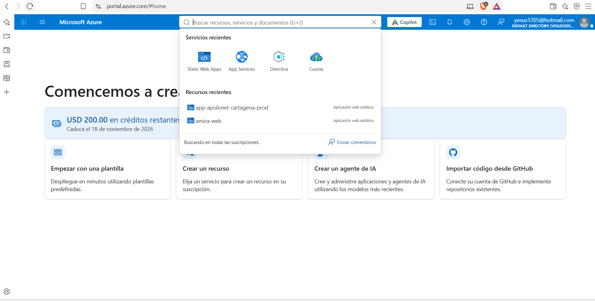
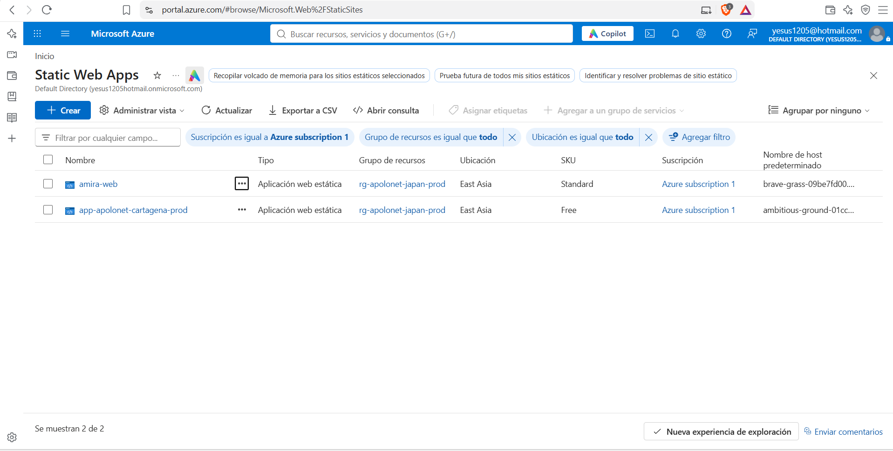
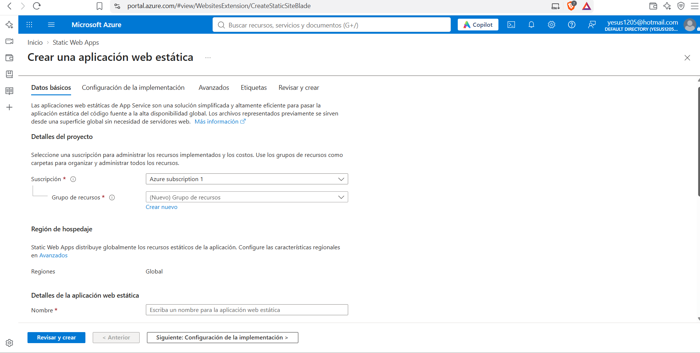
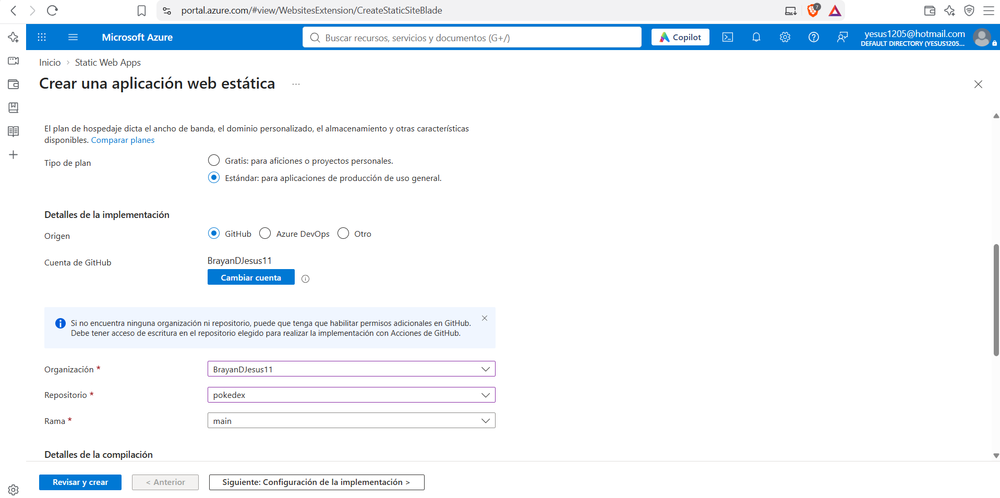
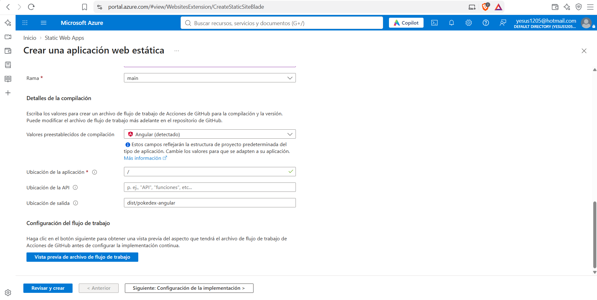
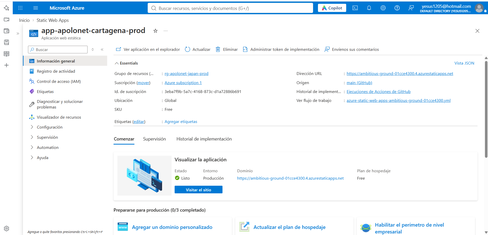

# 🚀 Despliegue de PokeDex Angular en Microsoft Azure

Aplicación web desarrollada con Angular y publicada en la nube mediante **Microsoft Azure Static Web Apps**, utilizando GitHub como repositorio del código fuente.

🌐 **Aplicación publicada:** [PokeDex Angular](https://ambitious-ground-01cce4300.4.azurestaticapps.net/)

📦 **Repositorio del proyecto:** [BrayanDJesus11/pokedex](https://github.com/BrayanDJesus11/pokedex)

📚 **Repositorio original:** [rcuello/ac4dem1a - PokeDex Angular](https://github.com/rcuello/ac4dem1a/tree/master/sistemas-distribuidos/poke-dex-lab)

## 📋 Requisitos

- Cuenta de Microsoft Azure.
- Cuenta de GitHub.
- Código fuente de PokeDex Angular.
- Node.js y npm para ejecutar y probar el proyecto localmente.
- Conexión a Internet.

## 1. Descargar y preparar el proyecto

Se descargó el código fuente original de PokeDex Angular en formato ZIP desde el repositorio proporcionado como referencia.

[Consultar el proyecto original](https://github.com/rcuello/ac4dem1a/tree/master/sistemas-distribuidos/poke-dex-lab).

Después de descargarlo, se descomprimieron los archivos y se abrió la carpeta del proyecto en el entorno de desarrollo.

Se instalaron las dependencias mediante el siguiente comando:

```bash
npm install
```

Posteriormente, se ejecutó la aplicación localmente con el comando configurado en el proyecto:

```bash
npm start
```

Se comprobó el funcionamiento de la aplicación antes de continuar con la publicación en la nube.

## 2. Configuración de environments

Durante la preparación del proyecto se revisó la configuración de los entornos de Angular, ubicados en la carpeta `src/environments`.

Estos archivos permiten establecer valores de configuración que utiliza la aplicación durante el desarrollo y la compilación.

Se revisó la configuración para que la aplicación funcionara correctamente durante las pruebas locales y el despliegue en Azure Static Web Apps.

Los archivos de entorno no deben incluir contraseñas, claves privadas ni credenciales sensibles.

## 3. Crear el repositorio en GitHub

Una vez probada la aplicación localmente, se creó un repositorio propio en GitHub siguiendo las indicaciones del docente.

Se subieron los archivos del proyecto, incluidos el código fuente y los archivos de configuración.

📦 **Repositorio utilizado:** [BrayanDJesus11/pokedex](https://github.com/BrayanDJesus11/pokedex).

Este repositorio se utilizó como origen del código para conectar GitHub con Azure Static Web Apps.

## 4. Ingresar a Azure Static Web Apps

Se ingresó al [portal de Microsoft Azure](https://portal.azure.com/) y se buscó el servicio **Static Web Apps** mediante la barra de búsqueda ubicada en la parte superior.

Después de acceder al servicio, se seleccionó el botón **Crear**, ubicado en la parte superior izquierda, para iniciar la configuración de una nueva aplicación web estática.



*Figura 1. Acceso al servicio Azure Static Web Apps.*



*Figura 2. Listado de aplicaciones web estáticas y opción para crear un recurso.*

## 5. Configurar los datos básicos

En el formulario de creación se seleccionaron la suscripción y el grupo de recursos correspondientes. Después, se definió el nombre de la aplicación web estática.

Para mantener una nomenclatura organizada, se pueden utilizar nombres descriptivos como los siguientes:

| Recurso | Ejemplo de nombre |
|---|---|
| Grupo de recursos | `rg-pokedex-prod` |
| Aplicación web estática | `pokedex-brayan-prod` |
| Repositorio | `pokedex` |
| Rama | `main` |

Los nombres anteriores son ejemplos y no necesariamente corresponden a los valores reales utilizados durante la creación del recurso.

En el tipo de plan se seleccionó **Free (Gratis)** para el proyecto académico.



*Figura 3. Configuración inicial de Azure Static Web Apps.*

## 6. Conectar GitHub con Azure

En la sección de configuración de la implementación se seleccionó **GitHub** como origen del código.

A continuación, se inició sesión con la cuenta de GitHub y se autorizó la conexión con el repositorio.

Se seleccionaron los siguientes valores:

- **Cuenta u organización:** `BrayanDJesus11`.
- **Repositorio:** `pokedex`.
- **Rama:** `main`.

Azure utiliza esta conexión para obtener el código fuente y configurar el flujo de publicación mediante GitHub Actions.



*Figura 4. Selección de la cuenta, el repositorio y la rama.*

## 7. Configurar la compilación de Angular

Azure permitió establecer los parámetros de compilación de la aplicación.

| Parámetro | Valor |
|---|---|
| Tipo de aplicación | Angular |
| Ubicación de la aplicación | `/` |
| Ubicación de la API | Vacía |
| Ubicación de salida | `dist/pokedex-angular` |

La ubicación de la aplicación corresponde a la raíz del repositorio. El campo de la API se dejó vacío porque no se configuró una API propia dentro de Azure Static Web Apps.

La ubicación de salida indica la carpeta que contiene los archivos generados para publicar la aplicación.



*Figura 5. Configuración de Angular y ubicación de salida.*

## 8. Crear y desplegar el recurso

Después de completar los datos básicos y los parámetros de implementación, se seleccionó **Revisar y crear**.

Azure presentó un resumen de la configuración. Después de revisar los datos, se confirmó la operación mediante el botón **Crear**.

Al finalizar la creación del recurso, se seleccionó **Ir al recurso** para acceder a su página de administración.

Azure configuró el proceso de compilación y publicación a partir del repositorio de GitHub.

## 9. Verificar la aplicación publicada

Desde la página del recurso se puede consultar el estado de la aplicación, su dirección pública y el historial de implementación.

Cuando la publicación finalizó, se abrió la dirección asignada para comprobar el funcionamiento de la Pokédex.



*Figura 6. Recurso creado y dirección pública de la aplicación.*

🌐 **URL de producción:** [PokeDex Angular](https://ambitious-ground-01cce4300.4.azurestaticapps.net/).

## 10. Corregir las rutas de Angular

Durante las pruebas se identificó un error `404` al actualizar directamente algunas rutas internas, como `/pokemon/2`.

Para solucionar el problema, se modificó el archivo `staticwebapp.config.json`, ubicado en la raíz del proyecto, y se añadió una regla de navegación que dirige las rutas de la aplicación a `index.html`. Esto permite que Angular gestione la navegación interna.

## 11. Configurar los encabezados de seguridad

En el mismo archivo `staticwebapp.config.json` se configuraron encabezados HTTP para reforzar la seguridad de la aplicación y se conservó la regla de navegación.

La configuración utilizada es la siguiente:

```json
{
  "globalHeaders": {
    "Content-Security-Policy": "default-src 'self' https: data: blob:; script-src 'self' https:; style-src 'self' 'unsafe-inline' https:; img-src 'self' data: https:; font-src 'self' data: https:; connect-src 'self' https:; object-src 'none'; base-uri 'self'; frame-ancestors 'none';",
    "Strict-Transport-Security": "max-age=31536000; includeSubDomains",
    "X-Frame-Options": "DENY",
    "Permissions-Policy": "camera=(), microphone=(), geolocation=()"
  },
  "navigationFallback": {
    "rewrite": "/index.html",
    "exclude": [
      "/assets/*",
      "/*.{css,js,png,jpg,jpeg,gif,svg,ico,woff,woff2}"
    ]
  }
}
```

### Función de los encabezados

| Configuración | Función |
|---|---|
| `Content-Security-Policy` | Restringe las fuentes desde las que se cargan los recursos. |
| `Strict-Transport-Security` | Establece HSTS por un año para reforzar el uso de conexiones HTTPS. |
| `X-Frame-Options: DENY` | Impide que la aplicación se muestre dentro de un marco. |
| `Permissions-Policy` | Restringe el acceso a la cámara, el micrófono y la geolocalización. |
| `navigationFallback` | Permite que Angular gestione las rutas internas de la aplicación. |
| `exclude` | Excluye determinados recursos estáticos de la regla de navegación. |

Después de aplicar la configuración, se volvió a publicar la aplicación y se comprobó que las rutas internas funcionaran correctamente al actualizar la página. Además, se realizó una auditoría con SSL Labs, en la que la aplicación obtuvo una calificación **A+**.
## ✅ Resultado final

- Se descargó y probó localmente el proyecto Angular.
- Se revisó la configuración de los entornos.
- Se creó un repositorio propio en GitHub.
- Se configuró Azure Static Web Apps.
- Se conectó GitHub con Azure para publicar la aplicación.
- Se corrigió el error `404` de las rutas internas.
- Se configuraron encabezados de seguridad.
- La aplicación quedó disponible mediante una dirección web pública.

## 📚 Referencias

- [Microsoft Azure](https://azure.microsoft.com/).
- [Documentación de Azure Static Web Apps](https://learn.microsoft.com/azure/static-web-apps/).
- [Documentación de Angular](https://angular.dev/).
- [PokéAPI](https://pokeapi.co/).
- [Repositorio original de PokeDex Angular](https://github.com/rcuello/ac4dem1a/tree/master/sistemas-distribuidos/poke-dex-lab).
- [Repositorio del proyecto](https://github.com/BrayanDJesus11/pokedex).
- [Aplicación desplegada](https://ambitious-ground-01cce4300.4.azurestaticapps.net/).

## 📝 Elaboración del documento

Este documento se elaboró utilizando **StackEdit**, un editor en línea de Markdown que permite redactar, organizar y previsualizar documentos técnicos antes de publicarlos en GitHub.
