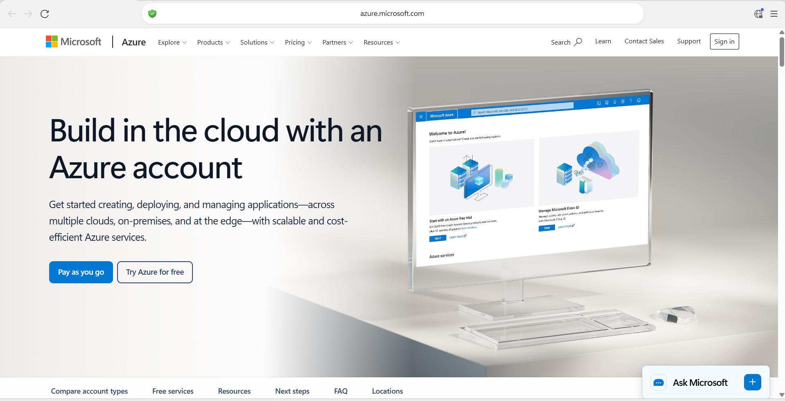
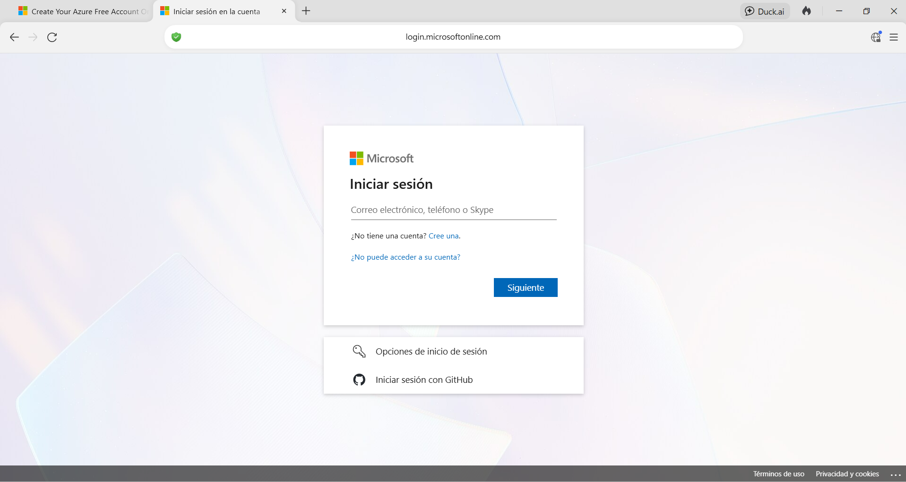
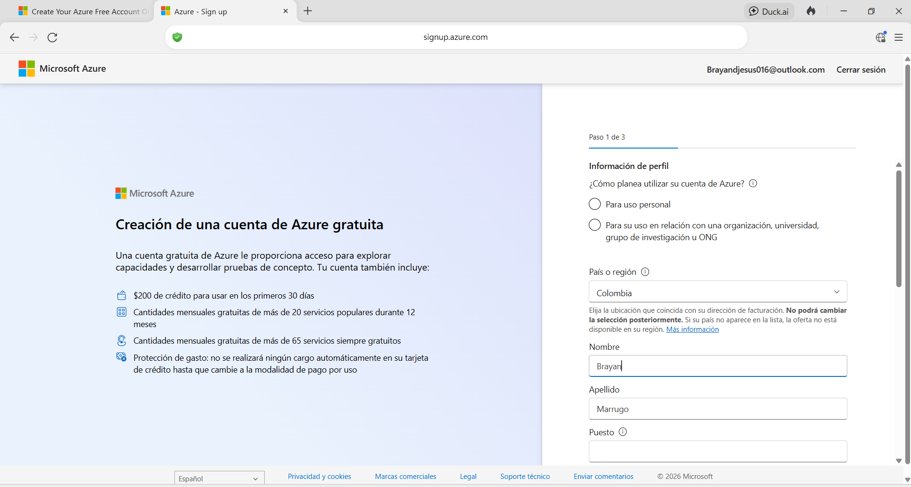
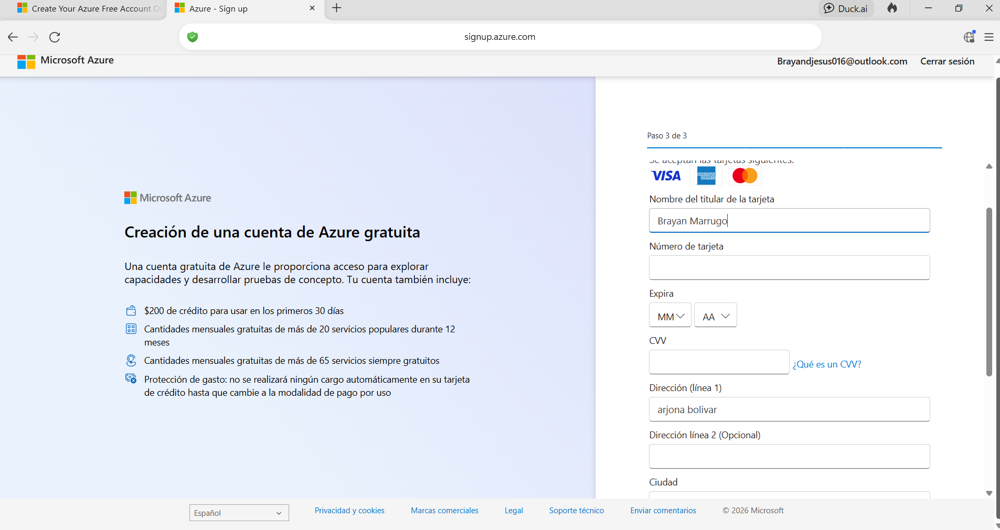
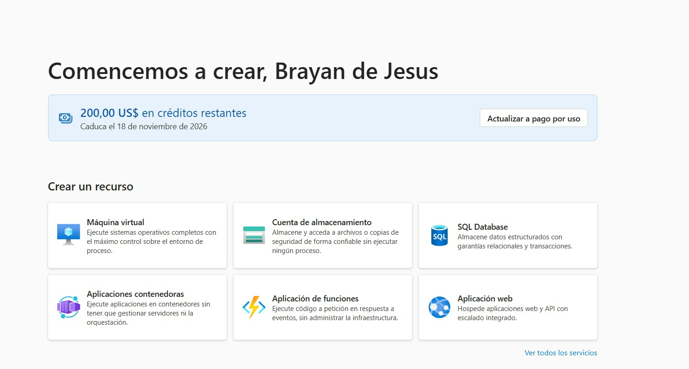

# Pokédex Angular

[](https://github.com/prettier/prettier)
[](https://codecov.io/gh/keilermora/pokedex-angular)
[](http://commitizen.github.io/cz-cli/)

[https://keilermora.github.io/pokedex-angular/](https://keilermora.github.io/pokedex-angular/)

La aplicación muestra el listado y el detalle de los Pokémon de las primeras 3 generaciones.

La imagen que representa un Pokémon en el listado muestra las variaciones que estos tuvieron durante las primeras versiones, desde la versión Green (1996) hasta la version Emerald (2005).

Los detalles de un Pokémon individual muestra sus estadísticas base y los registros de la Pokédex de las diferentes versiones.

El proyecto fue desarrollado usando la librería de JavaScript [Angular](https://angular.io/) para crear la interfaz de usuario, en comunicación con la Api RESTful [PokéAPI](https://pokeapi.co/).

## Requisitos mínimos

- [Nodejs](https://nodejs.org) con soporte de largo plazo (LTS).
- Un navegador web

## Ambiente de pruebas

Ejecutar en la raíz del proyecto:

```
npm start
```

## Referencias

- [Angular](https://angular.io/): One framework.
- [Angular Folder Structure](https://angular-folder-structure.readthedocs.io/en/latest/): Create a skeleton structure which is flexible for projects big or small.
- [Font Awesome](https://fontawesome.com/): The web's most popular icon set and toolkit.
- [Normalize.css](https://necolas.github.io/normalize.css/): A modern, HTML5-ready alternative to CSS resets.
- [PokéAPI](https://pokeapi.co/): The RESTful Pokémon API.


# PokeDex Angular - Creación de cuenta y despliegue en Microsoft Azure

## Descripción del proyecto

Este proyecto consiste en publicar una aplicación web Pokédex desarrollada con Angular en una plataforma de nube pública. Para realizar el despliegue se utilizó **Microsoft Azure**, mediante el servicio **Azure Static Web Apps**.

La aplicación permite consultar el listado y los detalles de los Pokémon de las primeras tres generaciones, utilizando la API REST de PokéAPI.

- **Aplicación desplegada:** [Pokédex en Azure](https://ambitious-ground-01cce4300.4.azurestaticapps.net/)
- **Proveedor de nube:** Microsoft Azure.
- **Servicio utilizado:** Azure Static Web Apps.
- **Código fuente original:** [PokeDex Angular - rcuello/ac4dem1a](https://github.com/rcuello/ac4dem1a/tree/master/sistemas-distribuidos/poke-dex-lab).
- **Repositorio del proyecto:** [BrayanDJesus11/pokedex](https://github.com/BrayanDJesus11/pokedex).
- **Documentación del despliegue:** [Despliegue.md](Despliegue.md).

Este documento explica paso a paso el procedimiento de registro de la cuenta de Azure utilizada para el proyecto.

## Contenido

1. [Requisitos](#1-requisitos)
2. [Ingreso al sitio oficial de Azure](#2-ingreso-al-sitio-oficial-de-azure)
3. [Inicio de sesión con Microsoft](#3-inicio-de-sesión-con-microsoft)
4. [Registro de la cuenta de Azure](#4-registro-de-la-cuenta-de-azure)
5. [Verificación de la cuenta](#5-verificación-de-la-cuenta)
6. [Acceso al portal de Azure](#6-acceso-al-portal-de-azure)
7. [Resultado del proceso](#7-resultado-del-proceso)
8. [Referencias](#8-referencias)

## 1. Requisitos

Para realizar el registro se necesitaron los siguientes elementos:

- Un navegador web con acceso a Internet.
- Una cuenta Microsoft, por ejemplo, Outlook o Hotmail.
- Información personal y de ubicación para completar el formulario.
- Un medio de pago admitido, si Microsoft lo solicita durante el proceso de verificación.

## 2. Ingreso al sitio oficial de Azure

Se ingresó al sitio oficial de Microsoft Azure para consultar las opciones disponibles y comenzar el registro de la cuenta.

Se seleccionó la opción **Try Azure for free** (Probar Azure gratis) para iniciar el procedimiento, de acuerdo con las opciones disponibles en la plataforma.

Enlace: [Sitio oficial de Microsoft Azure](https://azure.microsoft.com/).



*Figura 1. Página oficial de Microsoft Azure.*

## 3. Inicio de sesión con Microsoft

Después de seleccionar la opción para probar Azure gratuitamente, se abrió la página de autenticación de Microsoft.

Se inició sesión con una cuenta de Outlook. Si el usuario no dispone de una cuenta Microsoft, puede utilizar la opción de creación de cuenta que aparece en la página.



*Figura 2. Página de inicio de sesión de Microsoft.*

## 4. Registro de la cuenta de Azure

Una vez iniciada la sesión, se presentó el formulario de creación de una cuenta de Azure.

En esta etapa se completó la información solicitada por Microsoft, incluyendo los datos del perfil, el país o región y el tipo de uso de la cuenta.

Para este registro se seleccionó **uso personal** y **Colombia** como país o región.



*Figura 3. Formulario de información del perfil.*

## 5. Verificación de la cuenta

Durante el proceso de registro, Microsoft solicitó información de un medio de pago para verificar la cuenta y continuar con la activación.

Se completaron los datos requeridos por la plataforma siguiendo las instrucciones presentadas durante el registro.

**Nota de seguridad:** los requisitos de verificación y las condiciones de la oferta pueden cambiar. Antes de completar este procedimiento, se recomienda consultar las condiciones oficiales de Microsoft. No se deben compartir públicamente números de tarjeta, códigos de seguridad ni otros datos financieros.



*Figura 4. Formulario de verificación durante el registro.*

## 6. Acceso al portal de Azure

Al finalizar el proceso de registro, se accedió al portal principal de Microsoft Azure.

En esta página se muestran los créditos disponibles, cuando corresponda, y diferentes servicios que permiten crear y administrar recursos en la nube, como máquinas virtuales, bases de datos y aplicaciones web.

Enlace al portal: [https://portal.azure.com/](https://portal.azure.com/).



*Figura 5. Portal principal de Azure después del registro.*

## 7. Resultado del proceso

Como resultado del procedimiento, se obtuvo acceso al portal de Microsoft Azure y a los servicios disponibles en la cuenta.

Posteriormente, se utilizó Azure Static Web Apps para publicar la aplicación Pokédex y configurar los encabezados de seguridad correspondientes.

El procedimiento de compilación, publicación y configuración de la aplicación se encuentra documentado en [Despliegue.md](Despliegue.md).

## 8. Referencias

- [Sitio oficial de Microsoft Azure](https://azure.microsoft.com/).
- [Portal de administración de Azure](https://portal.azure.com/).
- [Opciones de compra y cuentas de Azure](https://azure.microsoft.com/en-us/pricing/purchase-options/azure-account).
- [Repositorio original de PokeDex Angular](https://github.com/rcuello/ac4dem1a/tree/master/sistemas-distribuidos/poke-dex-lab).
- [Repositorio del proyecto](https://github.com/BrayanDJesus11/pokedex).
- [Aplicación publicada en Azure Static Web Apps](https://ambitious-ground-01cce4300.4.azurestaticapps.net/).
